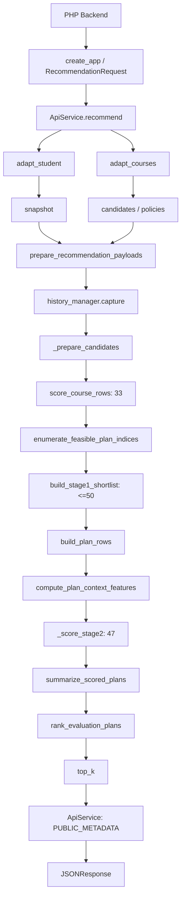

# رحلة طلب توصية واحد

هذا هو مسار واجهة الخدمة الحالي. لا يقرأ طلب التوصية ملفات طالب محلية، ولا يجلب رد الجامعة بنفسه، ولا يعيد تدريب مودل.

[التطبيق](api/app.md)

[الخدمة](api/service.md)

## الرسم العام



الأسماء داخل الرسم أسماء شفرة. ترتيب القراءة يبدأ من الخلفية الوسيطة، ثم حد النقل والتحقق، ثم تثبيت التاريخ والتوقع الأول والبحث، ثم إعادة توقع عضويات المختصر والرد المنقح.

## ١. الخلفية الجامعية تجلب وتصرح

الخلفية تتولى توثيق المستخدم وتفويض الوصول إلى الطالب والاختصاص. تجلب رد الطالب والمواد للهدف نفسه وتلحق سياق كل عملية جلب بصورة مستقلة.

```text
source_contexts.student = {student_id, degree_id, part_id}
source_contexts.courses = {student_id, degree_id, part_id}
```

مفتاح الخدمة عند بايثون يثبت جهة الاتصال، ولا يثبت صلاحية مستخدم الجامعة بنفسه. المحول يفحص الهوية الموجودة في كل رد قبل التصفية، ويطابق مصادر القيم والسجلات السابقة.

الرد الحالي للمواد لا يلزم أن يحمل هوية داخلية؛ مستوى الإثبات عندئذ شهادة من الخلفية. محول الطالب يثبت الهوية من حقوله الفعلية بالإضافة إلى سياق الجلب.

```text
payload_verified
php_attested
```

[أدوات الهوية](api/validation.md)

[عميل الجلب الاختياري](api/backend_client.md)

## ٢. حد النقل يثبت شكل الطلب

مصنع التطبيق يسجل نقطة التوصية بمفتاح الخدمة. مخططها يرفض حقولًا زائدة ويشترط هدف ساعات أو حدين مكتملين، وقطعًا تاريخيًا صريحًا.

```text
POST /api/v1/recommendations
create_app
RecommendationRequest
DecimalRequest.json
ApiService.recommend
```

تحليل الجسم يحتفظ بالساعات العشرية قبل المخطط. التنفيذ داخل عامل عمل، والأخطاء العامة لا تعيد جسم الطلب أو استثناءً بمسار خاص.

صحة النقل وجاهزية التوصية مختلفتان. واجهات التحقق تستمر حين لا توجد المودلات أو التاريخ؛ الفحص الذي يحتاج أصلًا مفقودًا يبقى غير متاح.

## ٣. الطالب يتحول إلى لقطة بداية

المحول يقرأ معلومات الاختصاص وملخص الفصول. يفحص هوية كل صف وفصله قبل إعلان نقص مخططه، ويرفض فصل الهدف أو المستقبل داخل التاريخ.

```text
studentDegreeInfo
studentSummaryInfo
adapt_student
_official_gpa_credits
_history
```

قيمة بداية المعدل تُنقل من المصدر، وعداد ساعات الإكمال لا يصبح مقامه. مقام التسجيل الرسمي يحتاج شهادة بداية الفصل، أو اشتقاقًا موثقًا من نهاية كاملة إضافية. مصادر مكملة متعارضة أو بوقت غير مقبول تُرفض.

حساب تاريخ المعدل الأصلي يُعاد استعماله: إذا اكتمل مخطط الحالة تستخدم الدالة الأصلية الكاملة؛ إذا كان جزئيًا يستخدم الحساب النقي المشترك الممكن. لا تصنع العدادات المفقودة.

```text
add_student_history_features
compute_student_gpa_history
ValidationResult.normalized
```

اللقطة قاموس بميزات الطالب والهوية ومقام حالي. قيمة عددية يقبل العقد فقدانها قد تبقى خالية مع إعلان النقص، لكن تاريخ الطالب اللازم والفجوات والمقام لا يتجاوز نقصها إلى توقع.

[شرح الطالب الكامل](api/student_adapter.md)

## ٤. المواد تتحول إلى مرشحين وقيود

المحول يفحص جميع الهويات والتكرارات المتعارضة قبل استبعاد غير المؤهل. كل مرشح يحمل الساعات الدقيقة ورقم المحاولة ونوع مادة الخطة من الكتالوج ونوع المتطلب ومجموعة مستقلة.

```text
ATTEMPTS_COUNT + 1 -> attempt_number
FINISH_STATUS -> normalize_previous_status
catalog.course_type_id -> plan_course_type_id
REQUIREMENT_TYPE_ID -> plan_requirement_type_id
[degree_id, REQUIREMENT_ID] -> requirement_group_id
```

صفر محاولات وحالة خالية مادة جديدة. عدد موجب وحالة خالية لا يعطي رسوبًا أو انسحابًا افتراضيًا. الاستثناء يحتاج تفويضًا، وراية اختيارية ليست تجاوزًا مطلقًا.

الخدمة تقاطع ساعات الطلب مع حدود التسجيل المؤكدة وتختار الحد الأعلى الفعلي هدفًا دقيقًا. سقف المجموعة مستقل عن نوع المتطلب، والإعادات الراسبة والمنسحبة مفصولتان.

[شرح المواد](api/courses_adapter.md)

[القيود](recommendation/constraints.md)

## ٥. الخدمة تنشئ مدخل النواة وتراجع القطع

المخرجان لا يمران مباشرة كمصفوفة مودل؛ الخدمة تصنع غلافين داخليين وتراجع الجاهزية وقطع تدريب المرحلتين.

```text
student_payload = {"snapshot": student.normalized, "candidates": candidates}
request_payload = {
  "student_id": "...",
  "degree_id": "...",
  "part_id": 20251,
  "target_credits": 6,
  "allowed_failed_repeat_credits": 6,
  "requirement_policies": [...],
  "requirement_group_policies": {...},
  "max_new_courses": ...
}
PreparedRecommendationInputs
```

هذه بنية مختصرة للعقد وليست جسمًا جاهزًا للإرسال. النواة تعيد التحقق من الهوية والأرقام والحالة والسياسات قبل التوقع.

الخدمة تفحص توفر القطع المطلوب؛ بعدها المحرك يلتقط اللقطة التي سيستعملها طوال الطلب. وجود فحص سابق في الخدمة لا يعني أن المحرك يخلط نسخًا داخل الطلب.

```text
normal -> previous_academic_part(target)
backtesting -> explicit mode + enabled setting + cutoff < target
```

حد الأداء الاختباري لا يقطع قائمة المواد؛ يرفض الطلب كاملًا عند تفعيله وتجاوز الحد. ليس سقف إنتاج معتمدًا.

[عقود النواة](recommendation/inputs.md)

[التحقق من التاريخ](features/frozen_history.md)

## ٦. سبع ميزات تاريخ إلى صف كل مادة

المحرك يثبت استراتيجية الأولى والنهائي ولقطة التاريخ، ثم ينسخ ميزات الطالب إلى صفوف المواد ويطبق سبع ميزات تاريخ مادة من النسخة المثبتة.

```text
TwoStagePlanRecommender._prepare_candidates
HistorySnapshot.apply
CourseHistoryState.apply
```

التاريخ يبحث من العام إلى الأخص الموجود وينعم القيم، ويسجل ضعف الدعم والفقدان. لا يدخل نتيجة الطالب المستهدفة أو نتيجة مادة الهدف إلى المجاميع.

## ٧. المرحلة الأولى: توقع المواد والبحث والاختصار

عقد المودل الكامل يحتوي اثنتين وأربعين ميزة عددية وخمسًا فئوية. الأربع عشرة المستبعدة من الأولى تصف الخطة والأقران، فيبقى ثمانية وعشرون عددية وخمس فئوية.

```text
47 = 42 numeric + 5 categorical
33 = 47 - 14 = 28 numeric + 5 categorical
stage_feature_contract("stage1")
score_course_rows
```

زوج الأولى يتوقع العلامة واحتمال الرسوب مرة لكل مادة. العلامة تقص إلى مجالها ثم تتحول لنقاط سلم النسخة؛ احتمال الرسوب يظل بعدًا مستقلًا.

البحث يولد جميع الخطط ذات الساعات الدقيقة، يطبق القيود، ويجمع توقعات موادها ويحسب التوازن والهوية. ثم يرتبها باستراتيجية الأولى ويأخذ خمسين على الأكثر.

```text
build_stage1_shortlist
enumerate_feasible_plan_indices
canonical_plan_identity
compute_balance_components
rank_evaluation_plans
```

[عقد الميزات](features/feature_contract.md)

[الاختصار](recommendation/shortlist.md)

## ٨. المرحلة الثانية: توقع عضويات الخطط

كل مادة في كل خطة مختصرة تصبح صفًا مستقلًا. سياق الخطة والأقران يحسب على معرف الخطة، لا على جميع المرشحين.

```text
build_plan_rows
compute_plan_context_features(..., group_columns=["plan_id"])
TwoStagePlanRecommender._score_stage2
47 features
```

لذلك عدد صفوف الثانية مجموع أعداد مواد الخطط المختصرة. المادة المشتركة قد تحصل على توقع مختلف باختلاف حمل الخطة وأقرانها.

من الأولى يعبر التوازن والهوية فقط. جبهة الأولى وتوقعاتها لا تصبح هدف النهائي.

## ٩. التلخيص والترتيب والرد

```text
quality = sum(credits * points)
expected_failed_credits = sum(credits * fail_probability)
expected_plan_gpa = quality / plan_credits
projected_cumulative_gpa = (start_gpa * prior_gpa_credits + quality) / (prior_gpa_credits + plan_credits)
```

الحساب التراكمي إضافي؛ الإعادة تحمل تنبيهًا بأن استبدال الدرجات يحتاج سياسة جامعية منفصلة. الترتيب الحالي جبهات مفاضلة في المرحلتين، ثم كسر تعادل ثابت.

بعد اختيار النتائج، الخدمة تستعمل قائمة بيضاء للبيانات الوصفية وتضيف القطع والوضع وتشخيص المدخلات. لا تعيد بيانات الطالب الخام أو المسارات الخاصة.

```text
pareto v1 -> pareto v1
top_k = 3
global_top_k_guaranteed = False
PUBLIC_METADATA
```

## مثال تتبع منقح

المثال التالي اصطناعي تعليمي، مبني على حقول العقود وشروط المحولين، لا بيانات جامعة. يوضح الطلب ومسار القيم؛ لم يُرسل إلى خدمة ولم ينتج منه توقع لمودل حقيقي.

### غلاف الطلب ومصدر الطالب

```json
{
  "student_id": "synthetic-student",
  "degree_id": "synthetic-degree",
  "part_id": 20251,
  "history_as_of_part": 20243,
  "target_credits": 6,
  "top_k": 3,
  "mode": "normal",
  "source_contexts": {
    "student": {
      "student_id": "synthetic-student",
      "degree_id": "synthetic-degree",
      "part_id": 20251
    },
    "courses": {
      "student_id": "synthetic-student",
      "degree_id": "synthetic-degree",
      "part_id": 20251
    }
  }
}
```

هذا جزء الهوية من المثال، وليس جسمًا كاملًا؛ يضاف الردان وسياق التكامل بالحقول التالية. الاختبارات القائمة توفر الغلاف الكامل والعينات المنقحة بدل نشر محتوى الجامعة.

[العينات الاصطناعية](../../tests/api_fixtures.py)

[اختبارات المقام والحالة](../../tests/test_api_academic_semantics.py)

معلومات بداية الطالب في المثال:

```json
{
  "STUDENT_ID": "synthetic-student",
  "DEGREE_ID": "synthetic-degree",
  "PART_ID": 20251,
  "FACULTY_ID": "synthetic-faculty",
  "GRADE_VERSION_ID": "3.111",
  "START_AGPA_POINTS": 3.0,
  "START_TOTAL_IN_COURSES": 8,
  "START_TOTAL_IN_CREDITS": 24,
  "TOTAL_REG_CREDITS": 30,
  "SEMESTER_REG_COURSES": 2,
  "SEMESTER_REG_CREDITS": 6,
  "DEGREE_CREDITS_COUNT": 120,
  "diploma_gpa": 90,
  "diploma_type_id": "13.111"
}
```

المقام ثلاثون لأن مصدره في المثال شهادة بداية موثقة، لا لأنه يساوي ساعات الإكمال الأربع والعشرين. مصدر المقام ضمن سياق التكامل:

```json
{
  "total_reg_credits_source": {
    "source": "synthetic_official_ledger",
    "target_part": 20251,
    "as_of_part": 20243,
    "timing": "beginning_of_semester",
    "rules_reference": "synthetic_inclusion_rules"
  }
}
```

تكتمل عدادات التسجيل والرسوب من مصادر سابقة موثقة. يحمل ملخص الطالب فصلين أقدم من الهدف بمعدلَيْن فصليين ثلاثة وثلاثة وعُشرين من مئة، وتسجيل معلوم، ومفاتيح حالة فريدة. لا يضاف معدل فصل الهدف.

### المادة قبل التحويل وبعده

سجل واحد تعليمي، وتوجد مادة ثانية مشابهة بمعرف آخر:

```json
{
  "COURSE_ID": "synthetic-course-A",
  "COURSE_NAME_SL": "synthetic_course_A",
  "COURSE_CREDITS": 3,
  "ATTEMPTS_COUNT": 0,
  "FINISH_STATUS": null,
  "IS_REQUESTABLE": "Y",
  "ALLOW_REGISTER": "Y",
  "STATUS_REASON_CODE": "REQUESTABLE",
  "REQUIREMENT_TYPE_ID": "synthetic-requirement-type",
  "REQUIREMENT_ID": "synthetic-group",
  "CREDITS_COUNT": 6,
  "REQUIREMENT_PASSED_CREDITS": 0,
  "YEAR_ORDER": 1,
  "SEMESTER_ORDER": 1
}
```

سجل الكتالوج مطابق للساعات والسقف والترتيب ونوع المتطلب، ويثبت نوع المادة. سياسة المجموعة في المثال متبقية صارمة، وحمل الدراسة وقواعد التسجيل ونطاق المحاولات موثقة في سياق التكامل.

```text
attempt_number = 1
previous_course_status = NEW
candidate_group = NEW
plan_course_type_id = catalog.course_type_id
requirement_group_id = group_identity(degree_id, REQUIREMENT_ID)
remaining_group_credits = 6
```

اللقطة والمعياران ينتقلان إلى صفين للأولى، وخطة واحدة ممكنة من ست ساعات، وصفين للثانية. العدد المطلوب ثلاثة حد أعلى؛ لا يصنع المحرك خطتين إضافيتين لملء العدد.

### حساب مفهوم النتيجة

نفترض لأجل الحساب فقط أن الثانية أعطت ثلاث نقاط للمادة الأولى وأربعًا للثانية، واحتمالَي رسوب عُشرًا وخمسة أجزاء من مئة. هذه قيم تعليمية مفترضة معلنة، وليست مخرجات مودلات الجامعة.

```text
quality_points = 3 * 3 + 3 * 4 = 21
expected_plan_gpa = 21 / 6 = 3.5
expected_failed_credits = 3 * 0.1 + 3 * 0.05 = 0.45
projected_cumulative_gpa = (3 * 30 + 21) / (30 + 6) = 111 / 36
```

الرد الفعلي يستعمل معرف خطة مبصومًا ومعلومات المودلات المسموح بها والقطع والوضع. صيغة مختصرة للمخرجات، مع قيم الحساب التعليمي فقط:

```json
{
  "status": "ok",
  "metadata": {
    "candidate_count": 2,
    "stage1_row_count": 2,
    "feasible_plan_count": 1,
    "shortlist_count": 1,
    "stage2_row_count": 2,
    "returned_plan_count": 1,
    "top_k": 3,
    "history_as_of_part": 20243,
    "part_id": 20251,
    "mode": "normal",
    "global_top_k_guaranteed": false,
    "production_ranking_strategy": "pareto v1 -> pareto v1"
  },
  "recommendations": [
    {
      "rank": 1,
      "total_credits": 6,
      "expected_quality_points": 21,
      "expected_plan_gpa": 3.5,
      "expected_failed_credits": 0.45,
      "projected_cumulative_gpa": 3.0833333333333335
    }
  ]
}
```

الحقول المحذوفة للاختصار، ومنها معرف الخطة وموادها، موجودة في النتيجة الحقيقية. المثال لا يثبت نجاح طلب ناقص ولا جاهزية إنتاج؛ اختبارات التكامل الحالية تثبت مصفوفتَي الثلاثة والثلاثين والسبعة والأربعين تحت مودلات اصطناعية محددة.

[اختبار التكامل الفعلي للنواة](../../tests/test_api_integration.py)

## أين يختلف المسار المحلي؟

الأداة المحلية تحمل طالبًا ومواد من ملفات محلية وتشغّل المحرك الرسمي السابق ذي سبع وأربعين ميزة، وتتوقع جميع الخطط الممكنة على دفعات. لا تمر عبر المحولين العامين ولا اختصار المرحلة الأولى.

[شرح الأداة المحلية](recommendation/local_cli.md)

[شرح المحرك المحلي](recommendation/engine.md)

