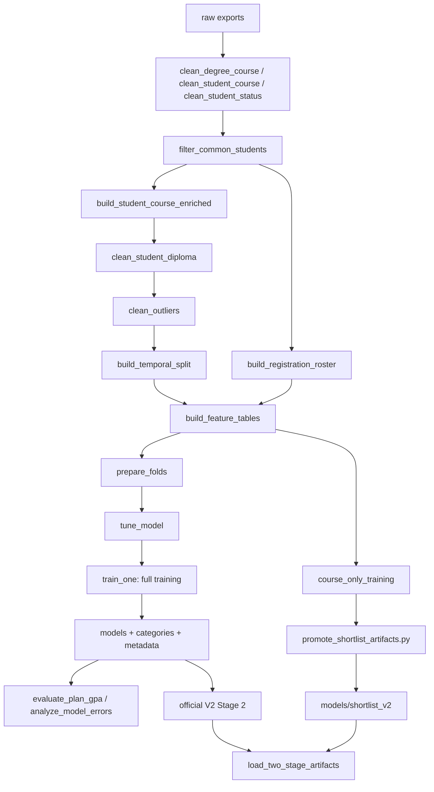

# من التصدير التاريخي إلى أصول التوقع

التدريب منفصل عن طلب الخدمة. هذا الفصل يشرح نقاط التنفيذ الحالية وآثارها، ولم تُشغّل هذه النقاط أثناء إعداد الدليل.

[منظم خطوات المشروع](main.md)

[المسارات والإصدارات](paths.md)

## الخريطة الفعلية للبناء



التاريخ الثابت للخدمة يبنى بطلب صريح من نتائج نهائية، ولا يندرج تلقائيًا في تشغيل جميع الخطوات. ترقية أصول الأولى عملية مستقلة عن تجربة ملاءمتها.

## ١. استيراد المصدر وتنظيفه

أداة التحويل المحلية تحول أوراق التصدير إلى سجلات، ولا تتصل بالجامعة. التنظيف يبدأ بأسماء الأعمدة والمعرفات وأنواع الأعداد.

[التحويل](data/xml_to_json.md)

[أدوات التنظيف](data/cleaning_utils.md)

كتالوج الاختصاص يعطي نوع المادة والمتطلب والساعات والترتيب. حالة الطالب تعطي قيم البداية والنهاية والتسجيل والمعدل والفجوات. نتائج المواد تعطي العلامة والنقاط ورقم المحاولة.

[الكتالوج](data/clean_degree_course.md)

[الحالة](data/clean_student_status.md)

[نتائج المواد](data/clean_student_course.md)

تنظيف النتائج يعد المحاولات في التاريخ المرصود بعد ترتيبها وقبل حذف الحالات النهائية غير المدعومة ورايات عدم الاحتساب. هذا سبب طلب شهادة نطاق عداد الجامعة في الاستدلال؛ العدادان يجب أن يصفا التاريخ نفسه.

تنظيف الحالة يحسب آخر معدل مسجل والفجوات قبل بعض تصفيات الدراسة. سجل تسجيل كامل مستقل يحفظ حمل الخطة، فلا يحسب السياق من المواد ذات العلامات الصالحة فقط.

## ٢. الربط والدبلوم والاستبعاد

تقاطع الطلاب يطبق على معرف الطالب فقط ويحفظ جميع صفوف الطالب المشترك. بعده يربط جدول النتائج بحالة الطالب على الطالب والاختصاص والفصل، وبالخطة على الاختصاص والمادة، مع تحقق تفرد جهة الربط.

[المزامنة](data/filter_common_students.md)

[الربط](data/build_student_course_enriched.md)

الدبلوم يربط متعددًا إلى واحد. القيم المتطرفة تظهر في جدول تدقيق بقاعدة وعدد وسبب؛ الاستبعاد الحالي على مستوى الطالب كله، وليس تعديل قيمة منفردة.

[الدبلوم](data/clean_student_diploma.md)

[الاستبعاد](data/clean_outliers.md)

هذه قواعد إعداد بيانات موجودة، ولا تتحول إلى سياسة أهلية أو تسجيل في طلب الشبكة.

## ٣. التقسيم الزمني الحالي

قوائم التقسيم ثابتة في وحدة التقسيم:

```text
train: 20201 .. 20243
test: 20251, 20252
incomplete: 20253
```

الفصل الثالث غير المكتمل خارج مجموعة الاختبار الحالية. اللاحقة الزمنية لا تكفي لمنع التسرب؛ يجب أن تعتمد ميزات كل صف على الماضي فقط.

[التقسيم](data/build_temporal_split.md)

[سجل التسجيل](data/build_registration_roster.md)

## ٤. هندسة الميزات

بناء الميزات يحسب تاريخ المادة للنتائج وللسجل الكامل، ثم يحسب سياق الخطة من سجل التسجيل ويربطه بمعرف النتيجة. بعدها يضيف تاريخ الطالب ونوع الفصل ووسم الرسوب.

```text
build_feature_tables
build_temporal_course_history
attach_plan_context
add_student_history_features
part_semester
is_fail = final_mark < 50
```

في التدريب يطبق تاريخ المادة على فصل قبل إدخال نتائجه. للاختبار تُنسخ حالة نهاية التدريب؛ يطبق الفصل الأول ثم يضيف نتائجه النهائية قبل الفصل التالي. الحالة المعادة للحفظ هي نهاية التدريب، لا نهاية الاختبار.

```text
20251 uses history through 20243
20252 uses history through 20251
test protocol: sequential_roll_forward
```

أوزان النتائج القديمة ربع منذ ما قبل سنة ألفين واثنتين وعشرين، والأحدث واحد. تستخدم هذه الأوزان في تاريخ المادة وفي ملاءمة المودل وفق التعريف القائم؛ لا يعاد وزن الماضي عند إضافة دفعة تاريخ جديدة.

[البناء](features/build_temporal_features.md)

[الحسابات الزمنية](features/temporal_features.md)

العقد الكامل اثنتان وأربعون عددية وخمس فئوية، ويمنع إدخال نتيجة الهدف ومعرفاته بوصفها ميزات مباشرة. تاريخ الاختصاص والحالة السابقة الموسعة تجارب، وليسا إضافات في المصفوفة الرسمية الحالية.

[العقد](features/feature_contract.md)

## ٥. ملاءمة الزوج الرسمي ذي سبع وأربعين ميزة

هدف العلامة عدد حقيقي من العلامة النهائية، وهدف الرسوب وسم من أقل من خمسين. التوقع يحول العلامة إلى نقاط لاحقًا؛ المودل الرسمي لا يتوقع نقاطًا مباشرة.

```text
TARGET_GRADE = final_mark
TARGET_FAIL = is_fail
regression / binary
```

الطية الأولى تلائم حتى آخر فصل من سنة ألفين واثنتين وعشرين وتتحقق في السنة التالية. الثانية تلائم حتى نهاية السنة التالية وتتحقق في سنة ألفين وأربع وعشرين.

```text
20223 -> 20231..20233
20233 -> 20241..20243
```

مستويات الفئات تتعلم من بيانات الملاءمة لكل طية فقط. تقارن ثلاث مجموعات معاملات بوقف مبكر. الاختيار للعلامة أقل متوسط خطأ مطلق، وللرسوب أقل متوسط فقد احتمالي. عدد دورات الملاءمة النهائية متوسط دورات التوقف المختارة مقربًا.

```text
balanced_31
capacity_63
regularized_47
MAE / log_loss
```

بعد الاختيار تتعلم الفئات من التدريب الكامل، ثم يدرَّب المودلان ويقيَّمان على الاختبار اللاحق. المقاييس والهدف والعقد والفئات والمصدر تحفظ مع الأصول. الاختبار لا يستخدم لاختيار المرشح.

[إعداد الأهداف والوزن](modeling/training_config.md)

[الملاءمة والاختيار](modeling/train_models.md)

## ٦. الأصول الموجودة والاختيار المعتمد

المرحلة الثانية هي الزوج الرسمي الحالي. العلامة اختارت مرشح السعة المصحح، والرسوب اختار المتوازن. كلاهما يستعمل سبعًا وأربعين ميزة وقطع تدريب نهاية سنة ألفين وأربع وعشرين.

```text
models/grade_regressor_v2.txt
models/fail_risk_classifier_v2.txt
models/model_metadata_v2.json
data/artifacts/category_levels_v2.json
grade: capacity_63
fail: balanced_31
training_as_of_part: 20243
```

المرحلة الأولى ترقية موثقة لأصول تجربة المواد المستقلة. مدرب التجربة يستعمل الطيات وشبكة المعاملات نفسها بعد حذف أربع عشرة ميزة سياق، ويفحص عدم تداخل التدريب والاختبار، ثم يسجل بصمات مصادره.

[مدرب مصدر الأولى](experiments/course_only_training.md)

[أداة الترقية](../../scripts/promote_shortlist_artifacts.py)

```text
models/shortlist_v2/grade_model.txt
models/shortlist_v2/fail_model.txt
models/shortlist_v2/category_levels.json
models/shortlist_v2/manifest.json
stage1: 33 features
training_as_of_part: 20243
```

المصدر المؤرشف يذكر اختيار العلامة المنتظم ذا سبع وأربعين ورقة، والرسوب مرشح السعة تحت تهجئة تاريخية محفوظة. هذا نص مصدر قديم مبصوم، وليس اسم المعامل الحالي في مدرب المودل الرسمي.

```text
stage1 original grade candidate: regularized_47
stage1 original fail candidate: capaciy_63
current training candidate name: capacity_63
```

لم يصحح دليل القراءة ملفات المصدر المؤرشفة لأن بصمتها جزء من عقد الترقية. لا يعني وجود التهجئة القديمة في الأرشيف أن الاختبارات الحالية ما زالت تفشل بسببها؛ آخر سجل كامل متاح ناجح.

## ٧. لماذا لا يقرأ التقديم كل ملفات التجارب؟

محمّل المرحلتين يقرأ البيان والأصول المعتمدة فقط. يطابق ترتيب الميزات وعددها والهدف الفعلي ومستويات الفئات والبصمات وسلم العلامات وقطع التدريب والسياسة البشرية.

[محمّل المرحلتين](recommendation/two_stage_artifacts.md)

[سياسة الاعتماد](recommendation/ranking_policy.md)

لا يعيد تشغيل اختيار المعاملات، ولا يحمل تجربة النقاط أو الحالة السابقة تلقائيًا، ولا يرجع إلى النسخة الأولى عند فشل الأصل. هدف التوصية يجب أن يلي قطع تدريب كل مرحلة، حتى لو تقدم تاريخ الخدمة بعده.

## ٨. التقييم والتجارب

تقييم معدل الخطة المرصودة يقارن جودة المواد المسجلة بالفعل. تحليل الأخطاء قد يلائم مودلات تاريخية لتوقع خارج الزمن ثم يجمع شرائح وتفسيرات. لذلك لا يعد مجرد عرض ملف بسيط.

[تقييم معدل الخطط](evaluation/evaluate_plan_gpa.md)

[تحليل الأخطاء](evaluation/analyze_model_errors.md)

تجارب النقاط والاختصاص ورقم المحاولة والحالة السابقة تكتب مخرجات معزولة وتراجع حماية الأصول. التجربة الناجحة إحصائيًا لا تصبح تلقائيًا أصل تقديم أو استراتيجية ترتيب.

[خريطة ملفات التجارب](01_PROJECT_MAP.md)

## ٩. حدود الأدلة والتوافق الدلالي

مسار البناء القياسي الحالي يستخدم النسخة الثانية للبيانات والميزات والملاءمة والتقييم. بعض الإرشادات القديمة تصف حدًا سابقًا بين الإصدارات؛ المرجع هنا التسجيل الفعلي في منظم الخطوات والمسارات.

يبقى توقيت إجمالي التسجيل في تصدير التدريب بحاجة إلى تأكيد جامعي. الدالة الأصلية تنقله مباشرة إلى ميزة التسجيل السابق، بينما محول الخدمة يثبت بداية الهدف رسميًا. التطابق العددي في اختبار اصطناعي لا يثبت التوقيت الحقيقي لكل سجل تاريخي.

قواعد استبدال درجات الإعادة مسألة منفصلة عن مقام التسجيل. لم تُبدل تعريفات الميزات أو المودلات أو مجموعات التدريب لتسوية هذا الاعتماد الخارجي.

تمرين قراءة: تتبع عمود ساعات التسجيل من تنظيف الحالة إلى بناء الميزات ثم مصفوفة الملاءمة ومحول الطلب، وحدد أين يثبت الوقت وأين يعتمد على المصدر.

