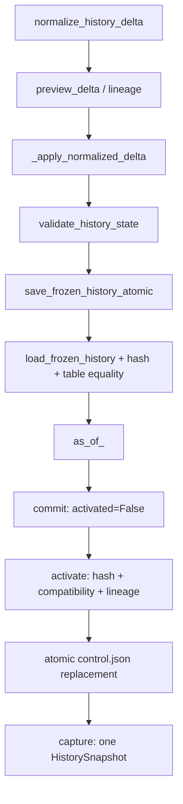

# التاريخ الثابت والتراكمي: من البادئة إلى المؤشر النشط

التاريخ هنا إحصاءات نهائية للمواد؛ ليس سجلًا خامًا لكل طالب، ولا أوزان مودل. يستعمله التدريب والاستدلال لتعويض غياب نتيجة المادة المستهدفة بمعلومات الماضي.

[حسابات التاريخ](features/temporal_features.md)

[بناء الحزم وقراءتها](features/frozen_history.md)

[الدفعات ومدير اللقطة](recommendation/history_update.md)

[المخزن الإداري الدائم](recommendation/cumulative_history.md)

## ١. ثلاثة أشياء لا يجب خلطها

**حالة تاريخ:** مجاميع مرجحة في خمسة مستويات مفاتيح ومستوى عام، مع قطع وإعدادات تنعيم ودعم.

```text
CourseHistoryState
effective_support / raw_count / mark_sum / fail_sum / attempt_sum / retake_sum
```

**حزمة ثابتة:** ملف حالة وبيانات وصفية وبصمات تحت اسم قطع دقيق. النسخة المكتملة لا تعدل في مكانها.

```text
as_of_<part>/course_history_state.pkl
as_of_<part>/metadata.json
```

**مؤشر نشط:** اختيار إداري دائم للحزمة التي يسمح استخدامها في خدمة المخزن التراكمي، مع دليل النسخ التي سبق تفعيلها.

```text
control.json
active
activated_versions
```

كتابة حزمة لا تعني تفعيلها. مدير الحزم السابق يبدل مرجعه المحلي بعد النشر؛ المخزن التراكمي يستعمل مديرًا مؤقتًا لذلك النشر ثم يترك المؤشر الدائم كما كان حتى عملية التفعيل.

## ٢. بناء اللقطات الأولية

البناء يأخذ كامل بادئة نتائج نهائية حتى القطع، لا نتائج القطع وحده. يثبت آخر فصل نهائي مصرح به ومفاتيح النتائج الفريدة وأعمدتها وأعدادها.

```text
build_frozen_history
finalized_through_part
source_min_part / source_max_part / source_part_counts
selected_source_sha256
```

يطبق كل فصل بالتسلسل داخل الحالة. النتائج القديمة تحتفظ بربع وزنها، والجديدة بوزن واحد. اسم الحزمة يجب أن يطابق آخر نتائج مختارة؛ غياب نتائج القطع المطلوب رفض.

[أداة البناء الصريح](features/build_frozen_history.md)

الأداة ليست جزءًا تلقائيًا من طلب التوصية أو تشغيل جميع خطوات البناء. الترحيل إلى المخزن الدائم لا يعيد بناء النتائج الفردية، بل ينقل حزمة تراكمية معتمدة موجودة بعد فحصها.

## ٣. الوضع المحلي المفحوص

الجذران السابقان يحتويان نسختين لكل منهما:

```text
data/artifacts/history/
  as_of_20243/
  as_of_20251/

data/artifacts/history_v2/
  as_of_20243/
  as_of_20251/
```

جذر المخزن التراكمي الافتراضي غير موجود أثناء هذا التدقيق. لا يوجد مؤشر دائم نشط فيه ولا دليل تنفيذ ترحيل فعلي لهذه المهمة.

```text
data/artifacts/history_incremental/
```

آلية الترحيل والتحديث والأوضاع والرجوع منفذة ومختبرة في مجلدات اصطناعية بحسب سجل الاختبارات السابق. لا يوصف تسلسل النسخ المقبلة بأنه منشور فعليًا في البيانات المحلية.

## ٤. أساس تراكمي حتى نهاية الفصل الأول من سنة ألفين وخمس وعشرين

الأساس يثبت جميع التاريخ الموافق عليه حتى القطع، بما فيه الفصول الأقدم. بيانات المصدر يجب أن تشير إلى فصول سابقة وفصل الأساس، وأن توافق عداد الصفوف ومجموع الحالة.

```text
BASELINE_PART = 20251
CumulativeHistoryStore.initialize
cumulative_history_confirmed = True
expected_source_hash
approval_reference
confirmation = True
```

المصدر محدد بإعداد الخدمة، لا مسار يرسله الطلب. الجذر الجديد لا يجوز أن يتداخل مع جذور الحزم القديمة. فاحص أصول الخدمة يجب أن يؤكد التوافق قبل نشر الأساس وتفعيله.

بصمة الحالة المرحّلة يجب أن تطابق الأصل. شهادة المشرف على اكتمال التاريخ لا تُستخلص آليًا من وجود المجاميع؛ المجاميع تثبت الاتساق بينما الجامعة تثبت الموافقة والاكتمال.

إذا نشرت نسخة الأساس ثم فشل حفظ المؤشر، إعادة العملية يمكن أن تتبنى المنشور المطابق بالكامل دون استبداله. اختلاف المصدر أو الاعتماد أو المجاميع يمنع ذلك.

## ٥. شكل الدفعة ومجاميعها

شكل النقل الإداري مختلف عن شكل النواة؛ محول الدفعة يصل بينهما.

```text
HTTP: part_id, rows, finalization
Core: delta_part, aggregates, finalized
```

الصف المجمّع يحمل المفاتيح والساعات والعدد ومجموع العلامات والرسوب والمحاولات والإعادات. مثال اصطناعي لنتيجتين نهائيتين بعلامتي أربعين وثمانين:

```json
{
  "part_id": 20252,
  "degree_id": "synthetic-degree",
  "course_id": "synthetic-course",
  "faculty_id": "synthetic-faculty",
  "plan_requirement_type_id": "synthetic-requirement",
  "course_credits": 3,
  "count": 2,
  "mark_sum": 120,
  "fail_count": 1,
  "attempt_sum": 3,
  "retake_count": 1
}
```

التطبيع يفحص الأعداد والمفاتيح وحبة التجميع ثم يرتب الصفوف ويبصم تمثيلًا ثابتًا. عدد الرسوب لا يتجاوز العدد، ومجموع العلامات يجب أن ينسجم مع عدد الراسبين والناجحين، ومجموع المحاولات مع عداد الإعادة.

```text
normalize_history_delta
HistoryDelta.delta_sha256
```

لا يوجد مجموع نقاط تقديري. أصول تطلب تاريخ اختصاص يحتاج مجاميع غير متاحة تُرفض بوضوح. لا يُستبدل هذا النقص بتاريخ أساسي مصنوع.

[محول الدفعة](api/history_adapter.md)

## ٦. كيف تتراكم النسخ؟

التسلسل التالي قدرات ومثال لنسخ جديدة بعد الترحيل، لا جرد لحزم موجودة فعلًا:

```text
as_of_20251 + Delta(20252) -> as_of_20252
as_of_20252 + Delta(20253) -> as_of_20253
as_of_20253 + Delta(20261) -> as_of_20261
```

المخزن الدائم يشترط الفصل التالي مباشرة وفق الرزنامة. مدير التاريخ الأساسي السابق يقبل دفعة أحدث غير مسجلة، بينما المخزن الإداري يضيف شرط عدم تخطي فصل.

لا يجمع الدفعة نفسها مرتين. البصمة المسجلة المطابقة تعطي تكرارًا معروفًا؛ فصل سبق تسجيله ببصمة مختلفة تعارض. لا تعاد صياغة الماضي أو أوزانه عند إضافة الجديد.

```text
already_applied
HISTORY_CONFLICT
OUT_OF_ORDER_DELTA
```

## ٧. النشر الذري ثم التفعيل



النشر يبني في مجلد مؤقت ضمن نظام الملفات نفسه، ويعيد التحميل ومقارنة الجداول والمجاميع والبصمات، ويحجز الوجهة ثم ينقل المجلد. الوجهة القائمة، ولو كانت ناقصة، لا تُكتب فوقها.

التفعيل يراجع الحزمة المكتملة وبصمتها وتوافق أصول الخدمة والسلسلة. بعدها يكتب ملف تحكم مؤقتًا ويفرغه ثم يستبدله ذريًا. طلب جار يحتفظ بلقطته القديمة؛ الطلب التالي يرى المؤشر الجديد.

## ٨. الإعداد الإداري الدائم والأدوار

الإعداد البيئي يحدد وضع بدء المخزن فقط. بعد حفظ ملف التحكم، الوضع المحفوظ هو المرجع. تبديل متغير داخل عملية بايثون لا يغني عنه.

```text
disabled
manual
auto_on_finalization
ADVISOR_HISTORY_UPDATE_MODE
```

في الوضع المعطل تمنع المعاينة الإدارية والنشر والتفعيل والتهيئة. واجهة التحقق القديمة للقراءة فقط تبقى تشخيصية؛ لا تتحول إلى كتابة.

المصادقة ثلاث جهات مستقلة: الخدمة العادية، الإدارة، والجهة الموثوقة لتثبيت الفصل. الخلفية الإدارية توثق المشرف وتراجع صلاحياته قبل استعمال مفتاح الإدارة.

```text
ADVISOR_API_KEY
ADVISOR_ADMIN_API_KEY
ADVISOR_FINALIZATION_API_KEY
```

القفل داخل العملية يمنع إدارة متزامنة، وقفل نظام التشغيل يسلسل العمليات على المخزن المحلي. أخطاء التحديث المحفوظة رموز وأوقات، لا أجسام طلب أو أسرار أو مسارات خاصة.

## ٩. تسلسل اليدوي، للقراءة والفهم

١. مشرف مخول يضبط الوضع اليدوي.

```text
PUT /api/v1/admin/history/mode
```

٢. عند أول مرة فقط، يعتمد أساسًا تراكميًا محدد المصدر والبصمة ويؤكد ترحيله.

```text
POST /api/v1/admin/history/initialize
```

٣. يفحص الدفعة للقراءة فقط، ثم يطلب معاينة إدارية مرتبطة بالأساس الحالي.

```text
POST /api/v1/history/deltas/validate
POST /api/v1/admin/history/preview
```

٤. يراجع البصمة وقطع الأساس والقطع المقترح والتوافق، ثم يرسل تأكيدًا بالرمز نفسه ومرجع نهائية.

```text
preview_token
confirmation = True
POST /api/v1/admin/history/commit
```

٥. النتيجة نسخة منشورة غير نشطة. يطابق المشرف بصمتها ثم يؤكد التفعيل المستقل.

```text
expected_history_sha256
POST /api/v1/admin/history/activate
```

هذا تسلسل توثيقي؛ لم تنفذ المهمة أي خطوة منه.

## ١٠. تسلسل الآلي عند تثبيت نهائي

يحتاج وضع التثبيت الآلي وحدثًا مصادقًا من جهة التثبيت المستقلة ومرجع موافقة نهائية موثوق. مجرد وصول الصفوف لا يكفي.

```text
POST /api/v1/admin/history/finalization-events
finalization.finalized_part_id
finalization.approval_reference
trusted_event = True
```

الحد العام يفحص هوية جهة الحدث ثم يفوض إلى المخزن، الذي يراجع الدفعة والترتيب والتوافق ويعاين وينشر ويفعل تحت عملية مسلسلة. إعادة الحدث المطابق لا تضاعف الدفعة. فشل أي خطوة يحافظ على المؤشر السابق ويسجل رمزًا آمنًا.

## ١١. قطع الخدمة والاختبار التاريخي والرجوع

في المعتاد يجب أن تكون نسخة التاريخ الفصل السابق بالضبط. هدف بعد تدريب المرحلتين وبعد التاريخ شرط مستقل.

```text
history_as_of_part = previous_academic_part(target_part)
history_as_of_part < target_part
training_as_of_part < target_part
```

الاستدعاءات القديمة التي لا تمرر القطع والسياسة الجديدة تحتفظ بمعنى اختيار المدير السابق؛ الواجهة العامة ترسل قطعًا ووضعًا صريحين دائمًا.

الاختبار التاريخي لا يسمح بنتيجة الهدف أو المستقبل، ويحتاج إعدادًا مفعّلًا. بعد رجوع المؤشر يمكنه الوصول إلى نسخة سابقة التفعيل حتى لو كانت أحدث من المؤشر المرتجع؛ النسخة المنشورة التي لم تُفعّل قط لا تصل إلى التوصية.

```text
mode = backtesting
ADVISOR_ENABLE_BACKTESTING = true
activated_versions
```

الرجوع تفعيل نسخة موجودة متوافقة ببصمتها وتصريح رجوع؛ لا يحذف النسخ التالية. التشغيل المعتاد لا يستعمل قطعًا بعد المؤشر النشط لتجاوز قرار الرجوع.

```text
rollback = True
HISTORY_VERSION_NOT_ACTIVATED
HISTORY_CUTOFF_AFTER_ACTIVE
```

نسخة نهاية ٢٠٢٦١ تصلح لأهداف بعده، ولا تصلح لتوصية داخل ٢٠٢٦١. النسخ التاريخية الأقدم من أساس المخزن قد تقرأ بقطعها الدقيق من الجذر السابق، بلا ترحيل صامت.

## ١٢. ما ثبت وما بقي خارجيًا؟

ثبت من الكود فصل المعاينة والنشر والتفعيل، والثبات والبصمة والتسلسل والتأكيد والرجوع وفحص التوافق. سجل اختبار سابق يختبر هذه المسارات اصطناعيًا؛ لم تنشئ هذه المهمة حزمًا.

بقي اعتماد اكتمال مصدر الجامعة ونهائية الفصل ومجاميع الاختصاص إن طلبتها أصول أخرى، وتهيئة التشغيل الفعلية للمخزن الجديد. لا تُصنع نتائج أو مجاميع لتعويضها.

[الوثيقة المعمارية القائمة](../API_CONFIGURATION_AND_CUMULATIVE_HISTORY.md)

[المرحلة الثالثة القائمة](../../plan_explanation/PHASE_03_HISTORY_DELTA_SAVE_ATOMIC_SWAP.md)

[المرحلة السابعة القائمة](../../plan_explanation/PHASE_07_MANIFEST_POLICIES_REVALIDATION.md)

[اختبارات المخزن](../../tests/test_cumulative_history.py)

[اختبارات الإدارة](../../tests/test_api_history_admin.py)

